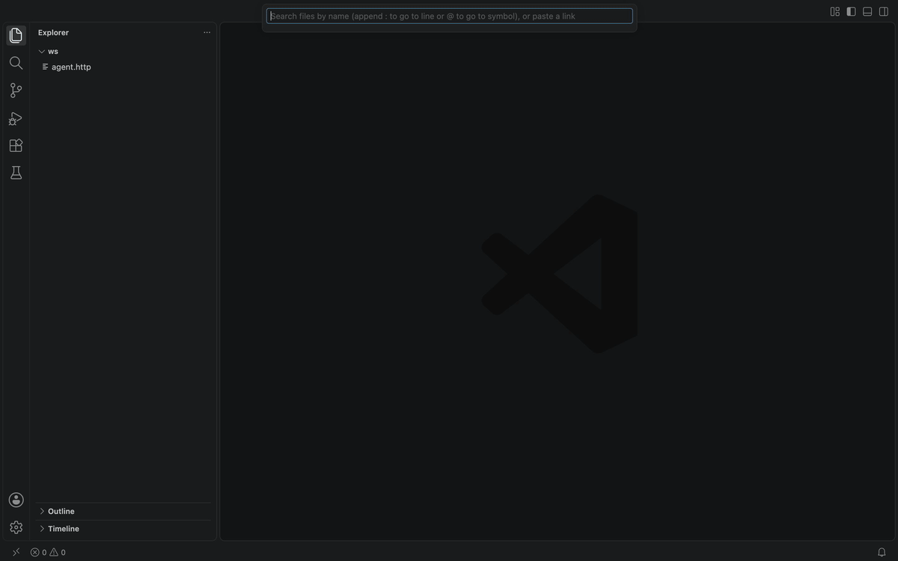

# Streamscope

Send HTTP requests from `.http` files and watch streaming responses arrive event by event: NDJSON, Server-Sent Events, chunked bodies and LLM streams, even when the server labels NDJSON as `application/json`. Capture a value from any single event, such as a `threadId` from a `RUN_STARTED` event, and use it in the next request while the stream is still running.



Streamscope reads the same request syntax as REST Client, so existing `.http` files work.

## Features

- **Live streaming responses.** Each event gets its own row as it arrives. NDJSON and Server-Sent Events are detected from the bytes, not only from `Content-Type`, and the Reply view assembles the text of AG-UI, OpenAI, Anthropic and Ollama streams.
- **Captures from single events.** `# @capture threadId = first(type == "RUN_STARTED").threadId` takes a value from one event, and a request that uses `{{threadId}}` waits for it instead of waiting for the stream to end. You can also click a value in the response and let Streamscope write the line.
- **Live checks.** `# @expect` lines pass or fail at the event that decides them, while the stream runs.
- **File runs in the Testing view.** Run every request of a file in order and see which passed, failed, errored or were skipped.
- **REST Client syntax.** Requests, file variables, request references, system variables, `rest-client.environmentVariables` and `http-client.env.json` environments.
- **Secrets kept out of sight.** `{{$secret name}}` values live in VS Code's secret storage, and credentials are masked in the log, hovers, history and errors.
- **Private.** No telemetry, no account, and no network requests except the ones you send.

## Quick start

1. Install Streamscope, then open or create a file ending in `.http` or `.rest`.
2. Write a request, with a URL you can reach in place of the example one:

   ```http
   ### Start agent run
   # @name startRun
   POST https://agent.example.test/run
   Content-Type: application/json

   {"message": "hello"}
   ```

3. Put the cursor in it and press `Cmd+Alt+Enter` (`Ctrl+Alt+Enter` on Windows and Linux), or click **Send Request** above it.

The response opens beside the editor. A stream shows each event as it arrives, and **Stop** above the request or in the panel cancels it.

## Streaming responses

Each request has one response panel, which a new run of the request replaces. Its views:

- **Events:** one row per event while the stream runs. Expand a row to see the event, open it in the editor with **Open Event in Editor**, or click a value and press **Capture This Value…**.
- **Reply:** the text assembled from an LLM stream's deltas, for AG-UI, OpenAI Chat Completions, OpenAI Responses, Anthropic Messages and Ollama streams.
- **Raw:** the response text exactly as received.
- **Headers:** the status line and response headers, the request as sent with credentials masked, each redirect and the timing.
- **Body:** a normal response's body, with JSON indented and numbers and duplicate keys kept as received.
- **Checks:** the result of each `# @expect` line.

Streamscope detects NDJSON and Server-Sent Events from the bytes, not only from `Content-Type`, and never adds an `Accept` header you did not write. To choose the format yourself, put `# @stream` on the request (see [Directives](#directives)). A long stream keeps its newest events in memory and older ones on disk, so it can run for hours. **Streamscope: Save Response** saves the body as received, after decompression, and **Streamscope: Show History** lists the session's last 50 runs.

## Captures

A `# @capture` line takes a value from a response, including from single events of a stream, for later requests:

```http
@baseUrl = https://agent.example.test

### Start agent run
# @name startRun
# @capture threadId = first(type == "RUN_STARTED").threadId
# @capture messageId = last(type == "RUN_FINISHED").result.messageId
# @capture secret sessionToken = headers["x-session-token"]
POST {{baseUrl}}/agent/run
Content-Type: application/json

{"message": "hello"}

### Continue
POST {{baseUrl}}/agent/continue
Content-Type: application/json

{"threadId": "{{startRun.threadId}}", "messageId": "{{messageId}}"}
```

- **When a value is ready.** `first(…)` and `nth(k, …)` resolve as soon as the matching event arrives, so a request can use `threadId` while the stream is still running. `last(…)`, `all(…)`, `count(…)` and `text` resolve when the stream ends; `status`, `headers` and `cookies` when the headers arrive; `body` and `jsonpath("$…")` when the body has arrived. A stream labelled `application/json` becomes NDJSON when its second line arrives, so a `first(…)` capture from its first line waits for that line; `# @stream ndjson` on the request reads it as NDJSON from the first line.
- **Capturing without typing.** Click a value in an expanded event or in the Body view and press **Capture This Value…**, or put the cursor on a value in an event or body opened in the editor and run **Streamscope: Capture This Value…**. Streamscope suggests a name, writes the line, such as `# @capture delta = nth(3, type == "TEXT_MESSAGE_CONTENT").delta`, on the request that produced the response, and selects it. Start the name with `secret ` to mask the value; a name or key that looks like a credential, such as `sessionId` or `auth`, gets `secret` on its own. The line takes effect the next time the request runs.
- **Reading a value.** `{{startRun.threadId}}` reads the capture of the request named `startRun`. `{{messageId}}` reads the newest capture with that name from a request in the same file that still has the `# @capture` line. A file variable, environment or `$shared` value of that name comes next, and a capture from another file only after them. So `@cursor = start` seeds a request that captures `cursor` itself: the first send uses `start`, later sends the captured value.
- **Waiting.** A request that needs a value still pending waits for it, up to `streamscope.capture.waitTimeout` (30 s), and its CodeLens shows "Waiting for startRun › threadId" beside **Stop**. If the producer has not run in this session and nothing else defines the name, the request is not sent, and the message offers to run it. Streamscope never sends a request you did not send.
- **Failures.** A capture that fails, such as an event that never arrived or a missing field, blocks the requests that need it, with the reason.
- **Seeing values.** After a run, the value or the reason it failed appears after each `# @capture` line, and the response panel lists the run's captured values.
- **Secrets.** A `secret` capture, a capture of a credential header such as `headers["x-session-token"]` or of a session cookie, and a capture whose name looks like a credential show as `••••••`. The response itself is shown as received.

Expressions can also filter and reshape values, for example `body.items[?status == "ok"].id | join(",")` or `body.next | default("none")`. [Expressions](#expressions) lists every source, operator and filter.

## Checks

A `# @expect` line states what a response must satisfy. It uses the capture expressions plus `exists(…)`, `before(…)` and `unique(…)`:

```http
### Start agent run
# @name startRun
# @expect status == 200
# @expect exists(first(type == "RUN_STARTED"))
# @expect count(type == "TEXT_MESSAGE_CONTENT") > 2
# @expect before(type == "RUN_STARTED", type == "RUN_FINISHED")
# @expect !exists(first(type == "RUN_ERROR"))
POST {{baseUrl}}/agent/run
```

- **Live:** each check settles at the first event that decides it, while the stream is still running, and never changes afterwards. `count(…) > 2` passes at the third match; `!exists(first(type == "RUN_ERROR"))` fails at the first error. A failed check does not stop the stream or block captures.
- **Results:** the Checks view lists every check with its expected and actual values, such as `status == 201` got 500. The status line shows `4/5 checks`, the CodeLens shows `✓ 200 OK · 120 events · 4.3 s · 5/5 checks`, and a ✓ or ✗ appears after each `# @expect` line, with the detail on hover.
- **Secrets:** values in a check's detail are masked the same way capture failures are.

## File runs

Each `.http` and `.rest` file is a suite in VS Code's Testing view, and each request is a test with a run button in the gutter. Run a whole file from the Testing view or with **Streamscope: Run File**:


```http
@baseUrl = https://api.example.test

### Start agent run
# @name startRun
# @capture threadId = first(type == "RUN_STARTED").threadId
# @expect status == 200
# @until type == "RUN_FINISHED"
POST {{baseUrl}}/agent/run

### Continue
# @name continue
# @timeout 30s
# @expect body.threadId == "synthetic-thread-1"
POST {{baseUrl}}/agent/continue
X-Thread: {{threadId}}
```

- **Order:** requests run in file order, one at a time, and each finishes, with its checks settled, before the next starts. The file's text when the run starts is used, saved or not.
- **Results:** a request passes when it gets a response and all its checks pass, whatever its HTTP status. A failed check is reported at its `# @expect` line, for example `` `status == 201` got 500 ``. A request that fails to connect, times out or cannot be sent is an error.
- **Skips:** a request that needs a capture from a request that failed, was not sent or was stopped in the same run is skipped, and the test output gives the reason. That carries down a chain of requests.
- **Stopping:** stopping the run cancels the request in progress; the rest stay not run.
- File runs open no response panels; a request whose panel is already open shows its new run there. The Testing view lists files in the workspace and untitled files, skips `node_modules`, and does not read a closed file that is itself a link or is over 1 MiB. File runs need a trusted workspace.

## Writing requests

A request is a request line, optional header lines, a blank line and an optional body. Requests are separated by lines starting with `###`, and lines starting with `#` or `//` are comments.

```http
@baseUrl = https://api.example.test

### List open orders
GET {{baseUrl}}/orders
    ?status=open
    &limit=20
Accept: application/json

### Create an order
POST {{baseUrl}}/orders HTTP/1.1
Content-Type: application/json

{"item": "item-1", "quantity": 2, "requestId": "{{$guid}}"}

### Import orders from a file
POST {{baseUrl}}/imports
Content-Type: application/json

<@ ./orders.json
```

- **Request line:** the method is optional and defaults to `GET`, and so is the HTTP version at the end. Query parameters can continue on the next lines, each starting with `?` or `&`.
- **Body files:** `< path` sends a file as it is, and `<@ path` replaces the variables in it first. Add an encoding to read it in something other than UTF-8, as in `<@latin1 path`. A relative path starts from the workspace folder or from the `.http` file's folder, and the file must be inside the workspace folder.
- **Unresolved values:** a request that refers to a value Streamscope cannot resolve is never sent, and the message names the variable and its line.

### Variables

- **File variables:** `@name = value` lines, used as `{{name}}` anywhere in the file. A value can refer to other variables.
- **Captures:** `{{threadId}}` or `{{startRun.threadId}}`, see [Captures](#captures).
- **Request references:** REST Client's `{{login.response.body.*}}`, `{{login.response.body.$.token}}` (JSONPath) and `{{login.response.headers.X-Token}}` read the latest response of the request named `login`.
- **Environments and secrets:** see [Environments and secrets](#environments-and-secrets).

System variables:

| Variable                     | Value                                                                                                   |
| ---------------------------- | ------------------------------------------------------------------------------------------------------- |
| `{{$guid}}`                  | A random UUID                                                                                           |
| `{{$randomInt 1 100}}`       | A random whole number from the first number up to, but not including, the second                        |
| `{{$timestamp}}`             | The current Unix time in seconds; `{{$timestamp -1 d}}` shifts it                                       |
| `{{$datetime iso8601}}`      | The current UTC time as `rfc1123`, `iso8601` or a format such as `"YYYY-MM-DD"`, with an optional shift |
| `{{$localDatetime rfc1123}}` | The same in local time                                                                                  |
| `{{$secret name}}`           | A value kept in VS Code's secret storage                                                                |
| `{{$dotenv name}}`           | A value from a `.env` file                                                                              |
| `{{$processEnv name}}`       | A variable from VS Code's own environment                                                               |
| `{{$shared name}}`           | The `$shared` environment's value, even when the active environment defines the same name               |

A shift is a whole number and a unit: `y`, `Q`, `M`, `w`, `d`, `h`, `m`, `s` or `ms`.

### Directives

Streamscope's directives go on comment lines before the request line:

| Directive                         | Effect                                                                                                          |
| --------------------------------- | --------------------------------------------------------------------------------------------------------------- |
| `# @name startRun`                | Names the request, so other requests can read its captures and response                                         |
| `# @capture threadId = …`         | Takes a value from the response or from one event (see [Captures](#captures))                                   |
| `# @expect status == 200`         | States what the response must satisfy (see [Checks](#checks))                                                   |
| `# @until type == "RUN_FINISHED"` | Ends a stream at the first matching event, closes the connection and counts the request as completed            |
| `# @stream ndjson`                | Reads the response as `sse`, `ndjson`, `json`, `text` or `raw` instead of detecting its format (`auto` detects) |
| `# @timeout 30s`                  | Limits the request's total time                                                                                 |
| `# @no-redirect`                  | Returns a redirect response instead of following it                                                             |
| `# @insecure`                     | Skips TLS verification for this request only                                                                    |

With `sse` or `ndjson`, the response is split into events; `json`, `text` and `raw` show it as one body.

### Editor support

Hover over `{{…}}` to see a value and where it comes from (secrets and credential-like values stay hidden). Completion offers variables after `{{` and directives after `# @`. Undefined variables get a warning, a capture or check with a syntax error is marked at its exact position and keeps the request from being sent, and the outline lists the file's variables and requests.

### What Streamscope sends

Streamscope sends the headers you write. Besides what HTTP needs (`Host`, `Content-Length`, `Connection`), it adds only `Accept-Encoding` when you did not set one, and `Authorization` when the URL holds user info. It decompresses gzip, deflate, br and zstd responses, follows redirects unless told not to, and uses VS Code's proxy settings, such as `http.proxy`.

## Expressions

`# @capture`, `# @expect` and `# @until` share one expression language. A syntax error is marked in the editor, and the request is not sent until it is fixed.

### Sources

| Expression                  | Value                                                                                           |
| --------------------------- | ----------------------------------------------------------------------------------------------- |
| `status`                    | The status code                                                                                 |
| `headers["x-request-id"]`   | A response header. The name is case-insensitive, and repeated headers are joined with `, `      |
| `cookies.session`           | A cookie set by this response's `Set-Cookie` headers                                            |
| `body`                      | The body, parsed when it is JSON, otherwise its text. On an event stream, read events instead   |
| `first(cond)`, `last(cond)` | The first or last event that matches `cond`; without a condition, the first or last event       |
| `nth(3, cond)`              | The third matching event, counting from 1                                                       |
| `all(cond)`                 | The list of matching events; a path after it applies to each one                                |
| `count(cond)`               | How many events match                                                                           |
| `text`                      | The reply text assembled from an LLM stream, as in the Reply view                               |
| `jsonpath("$.items[0].id")` | A JSONPath query (RFC 9535) on the body, or on the list of events of a stream                   |
| `exists(x)`                 | Checks only: true when `x` has a value                                                          |
| `before(cond1, cond2)`      | Checks only: true when the first event matching `cond1` comes before the first matching `cond2` |
| `unique(list)`              | Checks only: true when the list has no repeated items                                           |

A `jsonpath(…)` query that matches one node gives its value, several give a list, and none gives no value.

### Event conditions

Inside `first(…)`, `last(…)`, `nth(…)`, `all(…)`, `count(…)`, `before(…)` and `# @until`, a bare name such as `type` or `result.status` reads a field of the event. `@` is the whole event, and `@sse.event` and `@sse.id` are a Server-Sent Event's `event` and `id` fields.

### Paths

- `.name` or `["name"]` reads a field, and `[0]` reads an item of a list. A negative index such as `[-1]` counts from the end.
- `[*]` takes every item of a list, and `[?status == "ok"]` takes the items that match a condition, in which bare names read the item's fields. Both give a list.

### Operators

- Comparisons: `==`, `!=`, `<`, `<=`, `>` and `>=`.
- `x in ["a", "b"]` is true when `x` is an item of the list. `x contains "a"` is true when the text `x` contains `"a"`, or when the list `x` has `"a"` as an item. `x startsWith "a"` is true when the text `x` starts with `"a"`, and `x matches /^run-\d+$/` tests a regular expression.
- `&&`, `||`, `!` and parentheses combine conditions.

### Filters

A filter follows `|`:

| Filter                   | Effect                                                                                            |
| ------------------------ | ------------------------------------------------------------------------------------------------- |
| `default("none")`        | Gives this value when the expression has none. Without it, a missing value makes the capture fail |
| `join(",")`              | Joins a list into one text                                                                        |
| `json`                   | Turns the value into compact JSON, so a text keeps its quotes                                     |
| `match(/orders\/(\d+)/)` | Gives the first group of a regular expression, or the whole match when the pattern has no group   |

### Values

- Literals are texts in double or single quotes, numbers, `true`, `false`, `null`, lists such as `["a", "b"]`, and regular expressions such as `/run-\d+/i`.
- Regular expressions accept the flags `i`, `m`, `s` and `u`. Backreferences and lookaround are not supported.
- A captured text is inserted as it is, and a whole number keeps every digit. Other numbers are inserted the way JavaScript prints them, so `1.50` becomes `1.5`. An object or list is inserted as compact JSON.

## Environments and secrets

Variables come from, in order: captures, file variables (`@name = value`), the active environment, then `$shared`.

- **Environments** are read from REST Client's `rest-client.environmentVariables` setting, and from `http-client.env.json` and `http-client.private.env.json` next to the `.http` file or at the root of its workspace folder. For the same name, the private file wins over the public file, which wins over the setting. `$shared` values apply to every environment.
- **Choose the environment** from the status bar or with **Streamscope: Select Environment**. The choice is remembered per workspace.
- **`{{$secret name}}`** asks for the value once, keeps it in VS Code's secret storage for this workspace, and hides it everywhere Streamscope writes. Use **Streamscope: Set Secret**, **Streamscope: Clear Secret** and **Streamscope: List Secrets** to manage values, or **Streamscope: Move to Secret Storage**, offered as a quick fix on a line like `@apiToken = …`.
- **`{{$dotenv name}}`** reads `.env.<environment>` or `.env` next to the file, or in a parent folder up to the workspace folder.
- **`{{$processEnv name}}`** reads VS Code's own environment.
- Both accept `%name`, which first looks up the real name in the environment.
- A missing value never becomes an empty one: the request is not sent.
- An environment can set `"streamscope.insecure": true` to skip TLS verification for its requests.

## Settings

| Setting                                | Default                     | Description                                                                                |
| -------------------------------------- | --------------------------- | ------------------------------------------------------------------------------------------ |
| `streamscope.request.connectTimeout`   | `30s`                       | How long to wait for the connection, including the TLS handshake                           |
| `streamscope.request.headersTimeout`   | `300s`                      | How long to wait for the response headers once connected                                   |
| `streamscope.request.followRedirects`  | `true`                      | Follow redirects; `# @no-redirect` turns it off for one request                            |
| `streamscope.request.maxRedirects`     | `10`                        | The most redirects to follow for one request                                               |
| `streamscope.request.caFile`           | `""`                        | A PEM file of extra certificate authorities to trust, added to the default and system ones |
| `streamscope.capture.waitTimeout`      | `30s`                       | How long a request waits for a captured value that has not arrived yet                     |
| `streamscope.stream.maxEventSize`      | `16MiB`                     | The largest single event to read; a larger one becomes an oversize event with a preview    |
| `streamscope.stream.memoryEvents`      | `10000`                     | How many of the newest events of a stream stay in memory; older ones are read from disk    |
| `streamscope.stream.maxSpillSize`      | `512MiB`                    | The most raw data kept on disk for one streaming response                                  |
| `streamscope.stream.maxTotalSpillSize` | `2GiB`                      | The most raw data kept on disk across all runs in the history                              |
| `streamscope.stream.typeFields`        | `["type","event","object"]` | The JSON fields whose value labels an event, tried in order                                |
| `streamscope.view.default`             | `events`                    | The view a streaming response opens on until you pick another: `events`, `reply` or `raw`  |
| `streamscope.codeLens.enabled`         | `true`                      | Show Send Request and the last outcome above each request                                  |

Durations accept `500ms`, `30s` or `5m`, and sizes `512KiB`, `16MiB` or `2GiB`.

## Commands

Run commands from the Command Palette under **Streamscope:**. Each appears where it applies, in an `.http` file or a response, and you can bind any of them to a key in Keyboard Shortcuts.

| Command                                          | What it does                                                                           |
| ------------------------------------------------ | -------------------------------------------------------------------------------------- |
| **Streamscope: Send Request**                    | Sends the request under the cursor (`Cmd+Alt+Enter`, `Ctrl+Alt+Enter`)                 |
| **Streamscope: Stop Request**                    | Stops the request under the cursor                                                     |
| **Streamscope: Run File**                        | Runs every request of the file in the Testing view                                     |
| **Streamscope: Show Response**                   | Shows the response panel of the request under the cursor, or of a response document    |
| **Streamscope: Switch Response View…**           | Picks the panel's view: Events, Reply, Raw, Headers, Body or Checks                    |
| **Streamscope: Open Response Body in Editor**    | Opens the body in an editor, for large bodies                                          |
| **Streamscope: Open Response Headers in Editor** | Opens the Headers view as an editor document                                           |
| **Streamscope: Save Response**                   | Saves the body as received, after decompression                                        |
| **Streamscope: Capture This Value…**             | Writes a `# @capture` line for the value under the cursor in an event or body document |
| **Streamscope: Show History**                    | Lists the session's last 50 runs                                                       |
| **Streamscope: Select Environment**              | Picks the active environment                                                           |
| **Streamscope: Set Secret**                      | Stores a value for `{{$secret name}}`                                                  |
| **Streamscope: Clear Secret**                    | Removes a stored secret                                                                |
| **Streamscope: List Secrets**                    | Lists the names of stored secrets, never their values                                  |
| **Streamscope: Move to Secret Storage**          | Moves a file variable's value into secret storage (a quick fix on the variable's line) |
| **Streamscope: Show Log**                        | Opens Streamscope's output log                                                         |

## Using Streamscope with REST Client

Streamscope uses the same `http` language and reads REST Client's syntax, request references, system variables and `rest-client.environmentVariables`, so both extensions can open the same files. When REST Client or httpyac is installed, Streamscope offers once to turn off their Send link above each request, so only one shows. Streamscope's shortcut, `Cmd+Alt+Enter` (`Ctrl+Alt+Enter`), does not clash with REST Client's.

Not supported in this release:

- GraphQL requests, cURL import and export, and code snippet generation.
- A cookie jar: cookies from one response are not sent with later requests.
- Prompt variables (`# @prompt`) and request confirmation (`# @note`).
- Authentication helpers for Digest, AWS Signature v4, Azure AD and OpenID Connect, and client certificates. Basic authentication from user info in the URL works.
- `{{name.request.…}}` references and XPath in `{{name.response.body…}}`.

## Privacy

Streamscope sends no telemetry, needs no account, and makes no network requests except the ones you send. Responses stay on your machine: the newest events in memory, and every response body also in a private file (readable only by you) in Streamscope's storage folder, deleted when the run leaves the history, when VS Code closes, or at the next start after a crash. Secrets you enter stay in VS Code's secret storage.

## Security notes

- Credentials are masked wherever Streamscope describes a request or a captured value (the log, notifications, hovers, the Headers view's request, captured values, the Testing view, history and errors): `Authorization`, `Proxy-Authorization`, `Cookie`, `Set-Cookie`, API-key headers, URL user info, `{{$secret …}}` values, `secret` captures and the values of variables whose names look like credentials, such as `apiToken`. Credentials written in a URL query string are not masked, but a `{{$secret …}}` value there is. Response bodies, events and response headers are shown and saved as the server sent them.
- Redirects to another origin drop credential headers and any header that contains one of the masked values, and a 307 or 308 redirect never resends a request body to another origin or from https to http.
- TLS verification is on unless you opt out for one request (`# @insecure`) or one environment.
- Body files must lie inside the workspace folder, and a captured value or response can never choose which file is sent.
- The response panel runs with a strict content security policy and shows response data as text only.

Report a vulnerability privately as described in [SECURITY.md](SECURITY.md).

## Restricted workspaces

In a workspace you have not trusted, Streamscope still colours, outlines and checks `.http` files. Before sending, it asks once per session. It never reads secrets, `.env` files, `http-client.private.env.json`, environments from your user settings, process variables or body files there, ignores `# @insecure` and environment TLS opt-outs, and does not run files from the Testing view. It uses only your own `streamscope.request.caFile` setting, and only when it is an absolute path. When you trust the workspace, the values captured and the responses received until then are no longer used by later requests, so run their requests again.

## Accessibility

The response panel works from the keyboard alone: arrow keys move between its views and through the event list, and Enter opens an event. Its tabs, event list and live status use the roles screen readers expect, and it follows VS Code's colour themes, including both high-contrast themes. [Accessibility](docs/accessibility.md) lists the keys and the results of the keyboard and theme checks.

## Requirements

- VS Code 1.101 or later, on macOS, Windows or Linux, desktop only.

## Feedback and contributing

Report bugs in [GitHub issues](https://github.com/achrafelkhnissi/streamscope/issues), with made-up hosts, ids and values in place of real tokens and URLs. The source code is at [github.com/achrafelkhnissi/streamscope](https://github.com/achrafelkhnissi/streamscope).

## License

[MIT](LICENSE)
