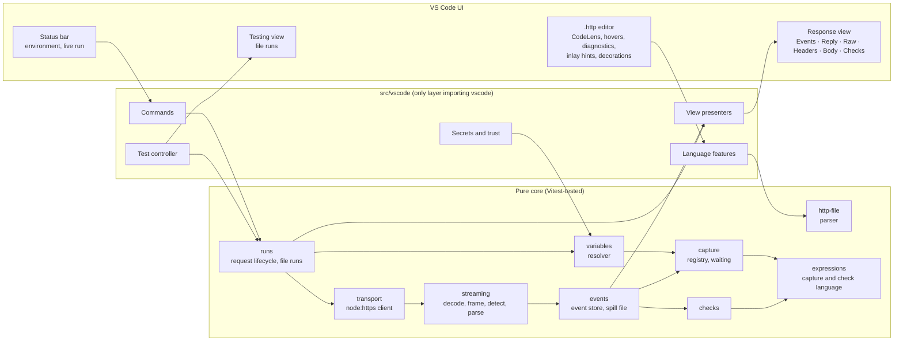
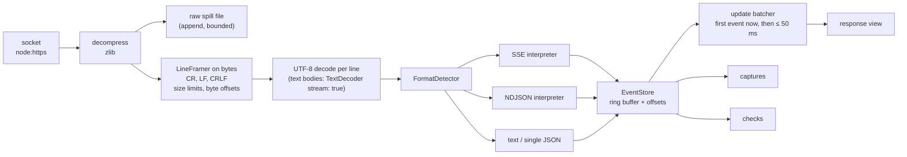
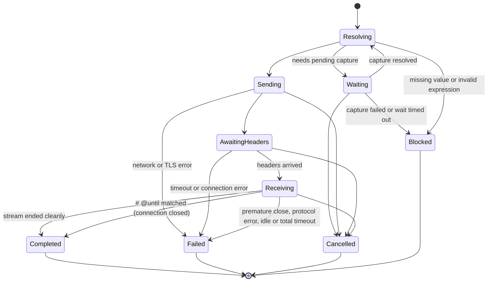

# Streamscope design

Status: approved 2026-11-11. Author of decisions: Achraf (publisher `achrafelkhnissi`). Items marked **(builder's call)** were decided by Claude during design and are open to change; everything else was decided by Achraf in Phase 1 to 3.

## 1. Product scope and MVP boundaries

### Why it exists

Developers who build streaming backends (LLM and agent APIs, NDJSON and Server-Sent Events endpoints) test them from `.http` files with REST Client, which shows nothing until the whole response has arrived and gives no way to reuse a value from one event in a later request. Today they wait for the full body and copy ids such as `threadId` and `messageId` by hand after every run.

Streamscope is a VS Code extension for `.http` files that:

1. shows streaming responses event by event as they arrive, and
2. captures values from individual events (or from any part of a normal response) and reuses them in later requests, without copying.

### Users

- First: the author's team, which builds an agent backend whose streaming endpoints return AG-UI events as NDJSON labelled `application/json` and refuse `Accept: text/event-stream`. They commit `.http` files to their repository, use them to test the project end to end, and work in VS Code.
- Next: any developer who builds backends that stream responses.

### Success, anti-goals

| Success (Achraf's words)    | Anti-goals                                           |
| --------------------------- | ---------------------------------------------------- |
| No more copying ids by hand | Events lag behind the network                        |
| Seeing events live          | VS Code freezes or slows down                        |
|                             | A request silently sent with an empty or wrong value |
|                             | A token or secret shown or stored in clear text      |
|                             | Needing an account, or sending telemetry             |

### MVP (first public release)

| Area         | In the first release                                                                                                                                                                                                                                                                                    |
| ------------ | ------------------------------------------------------------------------------------------------------------------------------------------------------------------------------------------------------------------------------------------------------------------------------------------------------- |
| Authoring    | REST Client core syntax (`###`, `# @name`, `@var = value`, `{{var}}`, headers, body, `< file`), request references `{{name.response.body.$.path}}` and `{{name.response.headers.X}}`, system variables (`$guid`, `$timestamp`, `$randomInt`, `$datetime`, `$dotenv`, `$processEnv`), `{{$secret name}}` |
| Environments | `rest-client.environmentVariables` settings and JetBrains `http-client.env.json` / `http-client.private.env.json`, environment picker in the status bar                                                                                                                                                 |
| Sending      | HTTP/1.1 over `node:https`, redirects, decompression (gzip, deflate, br, zstd), timeouts, cancellation, per-request TLS opt-out and custom CA, VS Code proxy settings                                                                                                                                   |
| Streaming    | SSE, NDJSON (including NDJSON labelled `application/json`), plain text, single JSON; format detected from content with a `# @stream` override                                                                                                                                                           |
| Viewing      | One response view per request with Events (default), Reply, Raw, Headers, Body and Checks; Stop; live status; captured-values summary                                                                                                                                                                   |
| Capture      | `# @capture` with every source, path form, condition and filter in section 10, `jsonpath()`, `secret`, click-to-capture                                                                                                                                                                                 |
| Checks       | `# @expect` lines evaluated live                                                                                                                                                                                                                                                                        |
| Runs         | Single requests and whole-file runs through VS Code's Testing view, `# @timeout`, `# @until`                                                                                                                                                                                                            |
| Platforms    | VS Code desktop 1.101 or later on macOS, Windows and Linux, local and remote (SSH, WSL, containers); forks best effort                                                                                                                                                                                  |
| Distribution | VS Code Marketplace and Open VSX                                                                                                                                                                                                                                                                        |

### Not in the first release

JavaScript scripts, GraphQL helpers, WebSocket and gRPC, cURL import and export, code generation, OAuth2 / AWS SigV4 / Digest helpers, client certificates, HTTP/2, cookie jar, persisted history, VS Code for the Web, CLI runner, streamed JSON arrays and JSON text sequences.

## 2. Functional requirements

### Authoring

- **FR-A1** Parse `.http` and `.rest` files with REST Client syntax: request separators `###` (with an optional title), request line, headers, body, `< path` body files, `#` and `//` comments, `# @name`, file variables `@name = value`.
- **FR-A2** Parse Streamscope directives as comment lines placed between the separator and the request line: `# @capture`, `# @expect`, `# @stream`, `# @timeout`, `# @until`, `# @insecure`, `# @no-redirect`. REST Client must still read the file, treating them as comments.
- **FR-A3** Editor features: syntax colouring (own grammar scope), CodeLens (Send, Stop, run state), document outline (one symbol per request), folding per request, hover on `{{…}}` showing the resolved value and its source (secrets masked), completion for variable names and directives, diagnostics for syntax errors, unknown variables, invalid expressions and duplicate `# @name`.
- **FR-A4** Quick fix "Move to secret storage" on file variables whose name looks like a credential (`token`, `bearer`, `apiKey`, `secret`, `password`, case-insensitive) and whose value is a literal.

### Sending

- **FR-S1** Send the request under the cursor (`Cmd+Alt+Enter` / `Ctrl+Alt+Enter`, CodeLens, command palette). Re-sending a request that is still running stops the running one first **(builder's call)**.
- **FR-S2** Resolve all variables before sending. If any value is missing, do not send; show where it is missing.
- **FR-S3** Never add headers the user did not write, except `Content-Length`, `Host` and `Accept-Encoding: gzip, deflate, br, zstd` **(builder's call: the last one only when the user did not set `Accept-Encoding`)**.
- **FR-S4** Follow redirects (up to 10) unless `# @no-redirect`; 301, 302 and 303 become GET; 307 and 308 replay the body; `Authorization` and `Cookie` are dropped on cross-origin hops; every hop is recorded.
- **FR-S5** Cancel at any time; cancellation closes the socket immediately.

### Viewing

- **FR-V1** The response view opens as soon as response headers arrive.
- **FR-V2** Views: **Events** (default for streams, remembered per user), **Reply** (only when the format is recognised, section 9), **Raw** (exact text, coloured), **Headers** (status line, response headers, request headers as sent with secrets masked, redirect hops, timing), **Body** (default for non-streaming responses; pretty-printed, coloured, foldable), **Checks**.
- **FR-V3** Live status: streaming, completed, failed, cancelled, timed out, blocked; event count; elapsed time; bytes; detected format and how it was detected.
- **FR-V4** Stop button while streaming.
- **FR-V5** Event detail: selecting an event shows its full pretty JSON.
- **FR-V6** Save a stream as `.ndjson` or `.sse`, and a body as a file.
- **FR-V7** The captured-values summary lists each capture of the request: pending, resolved (value, masked if secret) or failed (reason).
- **FR-V8** Each request has one response view; a new run of the request replaces its content. The command Show History lists the last 50 runs of the session (request title, status, events, time) and reopens any of them read-only **(builder's call)**.

### Capture

- **FR-C1** `# @capture [secret] name = expression` on the producing request (grammar in section 10).
- **FR-C2** `{{request.name}}` reads a capture of a specific request; `{{name}}` reads the most recent capture with that name from any request in the workspace session.
- **FR-C3** `first`/`nth` captures resolve as soon as the matching event arrives; `last`, `all`, `count` and `text` resolve when the stream ends.
- **FR-C4** A request that needs a pending capture waits for it (default 30 s, setting `streamscope.capture.waitTimeout`), showing "waiting for startRun › threadId" with a cancel action. If the value fails or times out, the request is blocked with an error.
- **FR-C5** A new run of the producer resets its captures to pending.
- **FR-C6** Click-to-capture: in event detail and Body views, "Capture This Value…" on a JSON value writes a `# @capture` line on the producing request, with a suggested name, the event condition (`first(type == "…")` or the discriminator in use) and the path. The user can edit the name before it is written.
- **FR-C7** After a run, an inlay hint after each `# @capture` line shows the value (masked if secret) or the failure.

### Checks

- **FR-E1** `# @expect expression` lines; each evaluates to true or false using the capture language plus `exists`, `count`, `before`, `unique` (section 10).
- **FR-E2** A check settles as soon as its answer is known, and fails early when it can no longer pass.
- **FR-E3** Results appear in the Checks view, as a summary in the status line, as ✓ / ✗ decorations beside each `# @expect` line, and in the Testing view during file runs. A failed check does not stop the stream or block captures.

### Runs

- **FR-R1** Each `.http` file is a test suite in VS Code's Testing view and each request is a test, with gutter run buttons.
- **FR-R2** A file run executes requests in file order, one at a time. A request passes when it receives a response and all its checks pass.
- **FR-R3** A request whose inputs depend on a capture that failed in this run is skipped with the reason.
- **FR-R4** `# @timeout <duration>` limits the whole request; `# @until <condition>` ends a stream when an event matches.

### Environments and secrets

- **FR-N1** Read environments from `rest-client.environmentVariables` (including `$shared`) and from `http-client.env.json` and `http-client.private.env.json` next to the file or at the workspace root. On name conflicts in the active environment, JetBrains files win over REST Client settings and the private file wins over the shared file **(builder's call)**.
- **FR-N2** Status bar picker for the active environment, remembered per workspace.
- **FR-N3** `{{$secret name}}` asks once in a masked input box, stores the value in SecretStorage scoped to the workspace, and masks it everywhere. Commands: Set Secret, Clear Secret, List Secrets.
- **FR-N4** Variable precedence for a bare `{{name}}`: capture, file variable, active environment, `$shared`.

### Coexistence

- **FR-X1** Reuse language id `http` with grammar scope `source.http.streamscope`; when REST Client or httpyac is installed, show a one-time notice offering to turn off their Send CodeLens (`rest-client.enableSendRequestCodeLens` for REST Client).

## 3. Non-functional requirements

| Area           | Requirement                                                                                                                                     | How it is checked                                     |
| -------------- | ----------------------------------------------------------------------------------------------------------------------------------------------- | ----------------------------------------------------- |
| Latency        | An event is visible at most 100 ms (p95) after its last byte arrives, at sustained 500 events/s of 1 KiB events                                 | Benchmark harness with timestamps from server to view |
| Responsiveness | No synchronous task of the extension blocks the extension host for more than 50 ms; typing in the editor stays smooth during a 30-minute stream | Long-task tracing in the benchmark; manual check      |
| Memory         | Extension heap stays under 150 MB regardless of stream length; older events live on disk                                                        | Benchmark with a 30-minute, 1,000 events/s stream     |
| Large bodies   | A 50 MB JSON body opens without freezing VS Code                                                                                                | Integration test with a synthetic body                |
| Startup        | Activation under 50 ms; nothing loads until a `.http` file opens or a command runs                                                              | Activation timing in integration tests                |
| Size           | Bundled extension under 400 KB                                                                                                                  | CI check on the VSIX                                  |
| Accessibility  | Every action is reachable from the keyboard and command palette; views work with screen readers                                                 | Manual pass with VoiceOver; native components first   |
| Security       | Section 15 controls; no telemetry; no network traffic except requests the user sends                                                            | Security tests and review                             |
| Compatibility  | VS Code 1.101 or later; macOS, Windows, Linux; local and remote hosts                                                                           | CI matrix, integration tests on 1.101.0 and stable    |
| Reliability    | Every request ends in exactly one terminal state; no leaked sockets, timers, files or listeners                                                 | Unit and integration tests on every exit path         |

## 4. Extension architecture



Principles:

- Five layers stay apart: transport, stream parsing, event processing, variable extraction, rendering.
- Only `src/vscode/` imports `vscode`. Everything else is plain TypeScript tested with Vitest and real local sockets.
- The core never waits on the UI. The UI subscribes to batched updates from the event store.
- The extension runs in the workspace extension host (`extensionKind: ["workspace", "ui"]`) so `localhost` means the machine where the code runs, including over SSH, WSL and containers.

## 5. Module responsibilities

| Module                    | Responsibility                                                                                                                                               | Depends on                          |
| ------------------------- | ------------------------------------------------------------------------------------------------------------------------------------------------------------ | ----------------------------------- |
| `src/http-file`           | Parse a document into requests with ranges: separators, names, directives, variables, request line, headers, body, body file references                      | nothing                             |
| `src/expressions`         | Lexer, parser and evaluator for capture and check expressions; error positions; `jsonpath()` through `@swaggerexpert/jsonpath`                               | nothing (plus the JSONPath library) |
| `src/variables`           | Resolve `{{…}}` from captures, file variables, environments, system variables, secrets, dotenv and process env; report each value's source; masking metadata | `http-file`, `expressions`          |
| `src/transport`           | Build and send requests with `node:http`/`node:https`; redirects, decompression, timeouts, TLS options, timing, cancellation; emit raw bytes                 | Node only                           |
| `src/streaming`           | UTF-8 decoding, line framing with size limits, format detection, SSE and NDJSON interpreters, reply adapters                                                 | nothing                             |
| `src/events`              | Event model, in-memory ring buffer, spill file, batched change notifications                                                                                 | `streaming`                         |
| `src/capture`             | Capture registry per session, resolution states, provenance, waiting with timeouts                                                                           | `expressions`, `events`             |
| `src/checks`              | Evaluate `# @expect` lines live, early failure                                                                                                               | `expressions`, `events`             |
| `src/runs`                | Request lifecycle state machine, file-run orchestration, skip rules                                                                                          | all core modules                    |
| `src/vscode/language`     | Grammar contribution, CodeLens, outline, folding, hovers, completion, diagnostics, quick fixes, inlay hints, decorations                                     | core                                |
| `src/vscode/response`     | Response view surface (chosen by the spike, section 13), status bar run indicator                                                                            | `events`, `runs`                    |
| `src/vscode/testing`      | Test controller mapping files and requests to test items                                                                                                     | `runs`                              |
| `src/vscode/secrets`      | SecretStorage access, secret commands, masking registry                                                                                                      | `variables`                         |
| `src/vscode/environments` | Environment discovery and picker, REST Client settings reader, JetBrains file reader, file watchers                                                          | `variables`                         |
| `src/vscode/log`          | `LogOutputChannel` with redaction                                                                                                                            | `variables` masking registry        |

## 6. HTTP transport

Verified in Phase 1: inside the extension host, VS Code patches `http`/`https` and global `fetch` with the user's proxy and certificate settings, but its `fetch` patch replaces any custom dispatcher, so per-request TLS options and timeouts are lost. The patched `https.request` keeps them and still inherits proxy, PAC, Kerberos and system CAs.

Design:

- **API.** `node:http`/`node:https` `request()`, called through the module object so VS Code's patch applies. A `Transport` interface keeps a future `fetch` implementation for VS Code for the Web possible.
- **Request body.** Strings from the file, or a stream from a `< path` file resolved inside the workspace folder (section 15). `Content-Length` is set when the size is known; otherwise chunked.
- **Headers.** Sent as written, in order, with original casing. Response headers are kept raw (`rawHeaders`) for display; duplicates are preserved.
- **Redirects.** Own loop (FR-S4) so every hop is visible and auth headers never cross origins.
- **Decompression.** `zlib` streams for gzip, deflate, br and zstd (zstd verified in VS Code 1.101's Node 22.15.1). The raw compressed byte count is recorded; decompressed bytes feed the stream pipeline immediately.
- **Timeouts.** Connect 30 s, until the socket is ready (TLS handshake included); response headers 300 s; `# @timeout` sets a total limit. All configurable. The idle timeout between body chunks (off for streams, with a "no data for N s" indicator; 60 s for non-streaming bodies **(builder's call)**) arrives with stream detection in M6, because until then a slow stream cannot be told from a stalled body.
- **TLS.** Verification on by default. `# @insecure` or an environment value `"streamscope.insecure": true` turns it off for that request only, after Workspace Trust. A custom CA (setting or environment) is merged with `tls.getCACertificates('default')` and `tls.getCACertificates('system')`, because passing `ca` alone makes VS Code stop adding system CAs.
- **Proxy.** Inherited from VS Code; nothing to configure in the extension.
- **Timing.** DNS lookup, connect, TLS handshake, time to first byte and total, from socket events.
- **Keep-alive.** VS Code's patch disables it; each request opens a new connection. Accepted.
- **Cancellation.** One `AbortController` per run; abort destroys the request and response streams and records `cancelled`.
- **HTTP/2.** Not supported in the first release (`node:http2` is not patched by VS Code).

## 7. Streaming pipeline



Rules:

- The socket is read at full speed. The UI never slows it down. The only backpressure is the spill-file write; if the disk cannot keep up, the socket pauses.
- The framer splits bytes on LF, CRLF and lone CR, carrying a pending CR across chunk boundaries. Each line records its exact byte offset and length in the decompressed stream. A leading BOM belongs to no line.
- Each complete line is then decoded as UTF-8. CR and LF never occur inside a multi-byte sequence, so a character split across chunks is rebuilt as the line accumulates. Invalid bytes become U+FFFD and one warning per stream, carrying the byte offset of the first invalid byte. Bodies that are not parsed into events (text, single JSON, raw) go through one `TextDecoder` in streaming mode, flushed at end of stream.
- The framer holds at most `maxEventSize` bytes of one line, and an undecided body at most 64 KiB plus one chunk. While the format is still being detected, lines up to 64 KiB are accepted whatever `maxEventSize` says, so a small limit never truncates a sniffed body.
- Small chunks are gathered: a line arriving in many pieces is copied into one growing buffer, and the spill file stages writes smaller than 64 KiB.
- Captures and checks evaluate on every event synchronously and cheaply; UI updates are batched: the first update goes out as soon as the current chunk has been parsed (in a microtask, never inside a parser callback), then at most every 50 ms, and immediately on end, error or cancel.
- The format detector runs once, but may upgrade single JSON to NDJSON (section 8).

## 8. NDJSON and SSE parsing

### Format detection

| Step                                       | Rule                                                                                                                                                                                                                                                        |
| ------------------------------------------ | ----------------------------------------------------------------------------------------------------------------------------------------------------------------------------------------------------------------------------------------------------------- |
| 1. Override                                | `# @stream` with `sse`, `ndjson`, `json`, `text`, `raw` or `auto` wins                                                                                                                                                                                      |
| 2. Content-Type                            | `text/event-stream` → SSE. `application/x-ndjson`, `application/jsonl`, `application/json-lines`, `application/stream+json` → NDJSON. `application/json`, `text/plain`, `application/octet-stream` or none → step 3. Anything else → text, no event parsing |
| 3. Sniff (first 64 KiB or first two lines) | Lines starting with `data:`, `event:`, `id:`, `retry:` or `:` → SSE. First line is complete JSON and more data follows on a new line → NDJSON. `{` or `[` alone on the first line → single JSON (pretty-printed body)                                       |
| 4. Upgrade                                 | A body treated as single JSON whose first value is complete while more bytes keep arriving becomes NDJSON. This covers NDJSON labelled `application/json`                                                                                                   |
| Never                                      | Add `Accept` or any header to steer the server                                                                                                                                                                                                              |

The status line shows the format and why, for example "NDJSON (detected; server said application/json)".

How detection behaves in practice (M4):

- Sniffing skips empty and whitespace-only lines. Only a first line starting with `{` or `[` counts as JSON, so a `text/plain` body of `42` or `true` stays text.
- A complete JSON object or array on the first line is shown as single JSON at once; the next non-empty line upgrades it to NDJSON, with the first line as event 1. The reason stays "detected" either way.
- A first line still incomplete after 64 KiB is decided from its prefix, and so is a completed first line of that length, so the result never depends on how the bytes were split. Such a body, like a pretty-printed one, is never upgraded.

### NDJSON

- One JSON value per line, LF or CRLF. Empty and whitespace-only lines are ignored.
- A line that fails to parse becomes a malformed event (line number, byte offset, parser message); the stream continues.
- A final line without a newline is parsed at end of stream and flagged as unterminated.
- Lines over the limit (default 16 MiB, `streamscope.stream.maxEventSize`) become an oversize event with a preview; the framer resynchronises at the next newline.
- Numbers are parsed with `JSON.parse` source-text access (verified in VS Code 1.101's Node 22.15.1) so large integers keep their exact digits when captured: an integer outside the safe range becomes a `bigint`. Only lines containing a run of 16 or more digits take this slower path.

### Server-Sent Events

Follows the WHATWG event stream interpretation:

- A leading BOM is removed. Lines starting with `:` are comments: they become `comment` events, which the Events view hides and Raw shows.
- `field: value` with one leading space removed; `data` lines join with `\n`; `event`, `id` (ignored if it contains NULL) and `retry` (digits only) are recorded.
- A blank line dispatches the event; an event without data is not dispatched. An incomplete final event is reported as discarded.
- If `data` parses as JSON, the event value is that JSON; otherwise it is text. The OpenAI-style `[DONE]` sentinel is shown as an end marker, not as malformed.
- `event: error` is shown as an error event; it does not change the transport outcome.
- Each event records the `id` of its own block, as `eventsource-parser` does, not the inherited last event ID: Streamscope never reconnects. An empty `event:` value means no event type.
- Comment lines become `comment` events. An event whose data passes `maxEventSize`, or that contains an over-limit line, becomes one oversize event with a preview; the next block parses normally.
- Behaviour is checked against `eventsource-parser` on every SSE fixture.

### Text and single JSON

Text bodies are appended as they arrive. A single JSON body is pretty-printed when complete; bodies over 1 MiB are parsed and pretty-printed in a worker thread **(builder's call)**.

## 9. Event processing

### Event model

| Field              | Meaning                                                                                                     |
| ------------------ | ----------------------------------------------------------------------------------------------------------- |
| `index`            | 1-based position in the stream                                                                              |
| `time`             | Milliseconds since the request was sent (monotonic clock)                                                   |
| `offset`, `length` | Location of the raw bytes in the spill file                                                                 |
| `kind`             | `json`, `text`, `malformed`, `oversize`, `comment`                                                          |
| `value`            | Parsed JSON or text (kept only while the event is in the ring buffer)                                       |
| `sse`              | `event`, `id`, `retry` for SSE                                                                              |
| `label`            | Display type, from the first present of the configured type fields (`type`, `event`, `object`, SSE `event`) |

### Retention

- For a run shown in an open view, the newest 10,000 events (`streamscope.stream.memoryEvents`) are kept in memory with parsed values, within at most 16 MiB of their raw bytes. Older events, and every event of runs that are only in history, keep only index, time, label and offsets; their bodies are re-read from the spill file on demand.
- That index uses typed-array blocks, about 27 bytes per event: roughly 49 MB for the 1.8 million events of a 30-minute stream at 1,000 events/s. The index keeps the newest 2,097,152 events (about 57 MB) and drops older summaries, so the budget holds however long the stream runs. Its first block starts at 1,024 entries and grows, so a short stream costs kilobytes, not a full block. Up to 4,096 distinct labels are kept; later new labels are read back from the spill file.
- The spill file lives in the extension's global storage with owner-only permissions, is capped at 512 MiB per response (`streamscope.stream.maxSpillSize`) and 2 GiB across history (`streamscope.stream.maxTotalSpillSize`, oldest runs lose raw data first) **(builder's call)**, and is deleted when its run leaves history or VS Code exits. Each extension host process uses its own directory; at start, directories of processes that have exited are removed, so one window never deletes another window's files. When a cap is reached, or a write fails, the stream continues, raw data stops being saved, and the view says so.

### Reply assembly

The Reply view concatenates text deltas using an adapter chosen from the first events:

| Adapter                 | Recognised by                                       | Text comes from                                               |
| ----------------------- | --------------------------------------------------- | ------------------------------------------------------------- |
| AG-UI                   | events with `type` `RUN_STARTED` / `TEXT_MESSAGE_*` | `TEXT_MESSAGE_CONTENT.delta` (and `TEXT_MESSAGE_CHUNK.delta`) |
| OpenAI Chat Completions | `object: "chat.completion.chunk"`                   | `choices[0].delta.content`                                    |
| OpenAI Responses        | `type: "response.output_text.delta"`                | `delta`                                                       |
| Anthropic Messages      | SSE `event: content_block_delta`                    | `delta.text`                                                  |
| Ollama                  | NDJSON with `message.content` or `response`         | that field                                                    |

Other formats show no Reply view. The same adapter powers the `text` capture source. The reply stops growing at 1,048,576 characters and is marked as cut off.

## 10. Variable extraction and resolution

### Capture lines

```http
### Start agent run
# @name startRun
# @capture threadId = first(type == "RUN_STARTED").threadId
# @capture messageId = last(type == "RUN_FINISHED").result.messageId
# @capture secret sessionToken = headers["x-session-token"]
POST {{baseUrl}}/agent/run
Content-Type: application/json

{"message": "hello"}

### Continue
POST {{baseUrl}}/agent/continue
Content-Type: application/json

{"threadId": "{{startRun.threadId}}", "messageId": "{{messageId}}"}
```

### Grammar

```text
capture    = "# @capture" [ "secret" ] name "=" expr
expect     = "# @expect" expr
expr       = or
or         = and { "||" and }
and        = not { "&&" not }
not        = [ "!" ] comparison
comparison = pipe [ ( "==" | "!=" | "<" | "<=" | ">" | ">=" | "in" | "contains" | "startsWith" | "matches" ) pipe ]
pipe       = access { "|" filter }
access     = primary { "." identifier | "[" index "]" | "[" string "]" | "[*]" | "[?" expr "]" }
primary    = source | literal | "(" expr ")" | identifier
source     = "status" | "headers" | "cookies" | "body" | "text"
           | ( "first" | "last" ) "(" [ expr ] ")"
           | "nth" "(" integer [ "," expr ] ")"
           | "all" "(" [ expr ] ")" | "count" "(" [ expr ] ")"
           | "exists" "(" expr ")" | "before" "(" expr "," expr ")" | "unique" "(" expr ")"
           | "jsonpath" "(" string ")"
filter     = "default" "(" literal ")" | "join" "(" string ")" | "json" | "match" "(" regex ")"
literal    = string | number | "true" | "false" | "null" | "[" literal { "," literal } "]" | regex
regex      = "/" chars "/" [ flags ]
index      = integer        (negative counts from the end)
```

Inside an event condition, bare identifiers refer to the event's fields (`type`, `result.status`); `@` refers to the event itself; `@sse.event` and `@sse.id` refer to SSE fields. Inside `[?…]`, identifiers refer to the current array element.

### Sources

| Source                                      | Value                                                                   |
| ------------------------------------------- | ----------------------------------------------------------------------- |
| `status`                                    | Status code                                                             |
| `headers["name"]`                           | Header value (case-insensitive name; repeated headers joined with `, `) |
| `cookies.name`                              | Value from `Set-Cookie` in this response                                |
| `body`                                      | Parsed JSON body, or text                                               |
| `first(cond)`, `last(cond)`, `nth(k, cond)` | One event's value; no condition means any event                         |
| `all(cond)`                                 | List of matching events; a following path maps over each                |
| `count(cond)`                               | Number of matching events                                               |
| `text`                                      | Assembled reply text (section 9)                                        |
| `jsonpath("…")`                             | RFC 9535 query on the body, or on the list of event values for streams  |

Checks add `exists(x)` (true if `x` resolves), `before(a, b)` (first event matching `a` comes before the first matching `b`) and `unique(list)`.

### Semantics

| Rule             | Behaviour                                                                                                                                                                                                       |
| ---------------- | --------------------------------------------------------------------------------------------------------------------------------------------------------------------------------------------------------------- |
| States           | Each capture is pending, resolved (value plus provenance: request, run, event index, path, time) or failed (reason)                                                                                             |
| New run          | Resets the producer's captures to pending                                                                                                                                                                       |
| Mid-stream       | `first`, `nth` and any `body`/`status`/`headers` expression resolve as soon as possible; `last`, `all`, `count`, `text` wait for the end                                                                        |
| Missing          | A path that does not exist, an event that never arrives, a cancelled or failed stream: the capture fails with the request, event and path segment named. `default(…)` is the only way to accept a missing value |
| Malformed events | Never match a condition; they are counted and reported                                                                                                                                                          |
| Values           | Strings are inserted as-is; numbers keep their original digits; objects and lists are inserted as compact JSON; `json` forces JSON                                                                              |
| Multiple results | A path with `[*]` or `[?…]` yields a list; `join` makes a string; inserting a list without `join` inserts JSON                                                                                                  |
| Errors           | Expression syntax errors are diagnostics with the exact column; the request will not send while one exists                                                                                                      |
| Safety           | No `eval`, `Function` or `vm`; regex execution has a 100 ms time budget **(builder's call)**                                                                                                                    |

### Resolution order

For `{{x}}` without a request prefix: latest capture named `x`, file variable `x`, active environment `x`, `$shared` `x`. For `{{name.x}}`: capture `x` of request `name`; if `name` is a request and `x` is `response`/`request`, the REST Client reference syntax applies. Hovering shows which one was used.

Environment and `.env` details, settled in M3:

- `$shared` is also read from `http-client*.env.json`, as Visual Studio does; without an active environment only `$shared` applies.
- `{{$processEnv}}` and `{{$dotenv}}` never send an empty value. An unset process variable or a missing `.env` key blocks the request, where REST Client sends an empty string or only warns.
- `.env.<environment>` and then `.env` are looked up from the `.http` file's folder upwards, stopping at the workspace folder (REST Client goes up to the filesystem root).
- Environment files belong to their own workspace folder: a file outside every folder uses only its own folder's environment files.
- Unresolved-variable diagnostics are warnings, because the value may come from an environment that is not selected; sending still blocks.

### Waiting

`streamscope.capture.waitTimeout` (default 30 s). While waiting, the request shows "waiting for startRun › threadId" with a cancel action. If the producer has never run in this session, the request is blocked immediately with a quick fix "Run startRun".

## 11. Request execution lifecycle



- Every run ends in exactly one terminal state. HTTP error statuses (4xx, 5xx) are `Completed` with that status; checks decide whether they count as failures.
- Failure kinds are distinguished: DNS, connection refused, TLS, timeout (which one), premature close, invalid chunked encoding, decompression error.
- Different requests can run at the same time. Re-sending a running request stops the earlier run first.
- File runs: requests run in file order; each must reach a terminal state before the next starts; requests needing a capture that failed in this run are skipped; stopping the run cancels the current request and marks the rest as not run.

## 12. Cancellation and resource management

- One `AbortController` per run, linked to VS Code `CancellationToken`s from commands and the Testing view.
- A run owns its socket, decompressor, decoder, framer, spill-file handle, timers and listeners. A single `dispose()` releases all of them on every exit path, and tests assert that no handles stay open.
- Spill files are deleted when history drops the run and on deactivate. Leftover files from a crash are removed at the next activation.
- Workers used for large bodies are terminated after each job.
- Everything the extension registers is added to `context.subscriptions`.

## 13. Response visualization

### What the view must show

Agreed in discovery: one response per request with Events (default), Reply, Raw, Headers, Body and Checks; switching views while streaming without losing data; Stop; live status; a captured-values summary; event detail with full JSON; click-to-capture; coloured Raw.

The approved mockup is [mockups/response-view.html](mockups/response-view.html): open it in a browser; it replays a synthetic agent run with the Events, Reply, Raw and Headers tabs, Stop and the captured-values strip. Body and Checks were added in discovery after the mockup and follow the same tab pattern.

### Two candidate surfaces

|       | Native                                                                                                                                                                                                                                   | Webview                                                                                                                              |
| ----- | ---------------------------------------------------------------------------------------------------------------------------------------------------------------------------------------------------------------------------------------- | ------------------------------------------------------------------------------------------------------------------------------------ |
| Shape | One read-only virtual document per response, with editor-title buttons switching its content between views; events as one line each with type colouring; event detail opens in a peek or side document; Testing and status bar for state | A response panel built with HTML: tab strip, virtualized event list with inline expansion, chips, captured-values strip, Stop button |
| Free  | Find, folding, syntax colouring, copy, theming, screen readers, Accessible View                                                                                                                                                          | Exact match to the approved mockup                                                                                                   |
| Costs | Each document update re-sends and re-diffs the whole content; inline expansion and per-view tabs are approximations                                                                                                                      | Accessibility, theming and keyboard navigation built by hand; CSP and XSS surface; not covered by Accessible View                    |

### Decision rule

Native first, as agreed. Milestone M5 (roadmap) is a time-boxed spike that builds both surfaces far enough to stream a synthetic 30-minute AG-UI run at 500 events/s, then measures event latency (p95), extension host long tasks, renderer CPU and memory, and checks the experience against the mockup. Native is chosen if it meets every section 3 budget and supports Events, Reply, Raw, Headers, Body, Checks, Stop and click-to-capture without awkward workarounds. Otherwise the webview is used, with these safeguards:

- CSP `default-src 'none'`, scripts and styles only from the extension with nonces, `localResourceRoots` limited to the extension.
- Response content inserted with `textContent` only; HTML previews (if ever) in a sandboxed iframe.
- Messages batched and capped; the webview never holds more than the visible window plus a margin.
- VS Code theme variables only; keyboard navigation and ARIA roles for the event list.

Whichever wins, Raw uses VS Code's built-in `jsonl` colouring for NDJSON (verified present in 1.101) and a small grammar for SSE.

### Editor-side presentation (both surfaces)

- CodeLens above each request: "Send", or "Stop · 34 events · 2.1 s" while running, then "✓ 200 · 120 events · 4.3 s · 5/5 checks".
- Inlay hints after `# @capture` lines with values; ✓ / ✗ decorations on `# @expect` lines.
- Status bar: active environment; a live run indicator with Stop.

## 14. State management

| State                 | Where                                                                                        | Lifetime                                                                                         |
| --------------------- | -------------------------------------------------------------------------------------------- | ------------------------------------------------------------------------------------------------ |
| Runs and their events | Memory (parsed events for open views, summaries for history) and spill files                 | The last 50 runs of the session stay in history **(builder's call)**; nothing survives a restart |
| Captures              | Memory, per workspace session                                                                | Until VS Code closes or the producer runs again                                                  |
| Active environment    | `workspaceState`                                                                             | Per workspace                                                                                    |
| Last chosen view      | `globalState`                                                                                | Per user                                                                                         |
| Secrets               | SecretStorage, key `streamscope:<workspace hash>:<name>`                                     | Until cleared                                                                                    |
| Request identity      | `# @name` when present, otherwise file URI plus request order and a hash of the request line | Survives edits that do not reorder requests                                                      |

Nothing is written to the workspace except files the user asks to save.

## 15. Security and secret management

### Threat model

| Threat                                                                         | Control                                                                                                                                                                                                                                            |
| ------------------------------------------------------------------------------ | -------------------------------------------------------------------------------------------------------------------------------------------------------------------------------------------------------------------------------------------------- |
| A cloned repository's `.http` or env files run something or exfiltrate secrets | No code execution from files; Workspace Trust limited mode (below); requests are sent only by explicit user action                                                                                                                                 |
| Secrets shown or stored in clear text                                          | SecretStorage only; masking registry used by every output the extension writes; the capture system never writes `secret` values to history or disk (response bytes that contain them stay only in the owner-only spill file, deleted with the run) |
| Expression libraries executing code                                            | Own expression language without `eval`; `@swaggerexpert/jsonpath` (RFC 9535, no eval) only; JSONPath libraries with code-execution CVEs are banned                                                                                                 |
| Response content attacking the UI                                              | Native views render text only; a webview, if chosen, follows the CSP rules in section 13                                                                                                                                                           |
| Body files reading outside the project                                         | `< path` resolves inside the workspace folder; symlinks resolving outside are rejected; in restricted mode body files are not read                                                                                                                 |
| TLS downgrade                                                                  | Verification on by default; opt-out per request or environment only, never global, never via `NODE_TLS_REJECT_UNAUTHORIZED`                                                                                                                        |
| Supply chain                                                                   | One runtime dependency; npm `ignore-scripts`, exact versions, 7-day release cooldown; SHA-pinned CI actions; release from a protected environment with OIDC                                                                                        |

### Workspace Trust

`capabilities.untrustedWorkspaces: { supported: "limited", restrictedConfigurations: ["streamscope.request.caFile"] }` and `capabilities.virtualWorkspaces: { supported: "limited" }`. In a restricted workspace:

| Feature                                                              | Trusted | Restricted                                                          |
| -------------------------------------------------------------------- | ------- | ------------------------------------------------------------------- |
| Editing, colouring, outline, diagnostics                             | Yes     | Yes                                                                 |
| Sending a request by explicit click                                  | Yes     | Yes, after a one-time confirmation per session **(builder's call)** |
| `{{$secret}}`, `.env`, `http-client.private.env.json`, `$processEnv` | Yes     | Not resolved (request blocked with an explanation)                  |
| Environments from the user's own settings                            | Yes     | Not read (only workspace-level values)                              |
| `< path` body files                                                  | Yes     | No                                                                  |
| `# @insecure`, custom CA settings from the workspace                 | Yes     | Ignored; a relative user `caFile` blocks the request                |
| File runs from the Testing view                                      | Yes     | No                                                                  |

The confirmation comes only for a request that would otherwise be sent, just before connecting, so a blocked request never asks; declining cancels it. Restricted mode is tested by `npm run test:restricted`, which opens a real untrusted folder because the standard test runner always disables Workspace Trust.

### Masking

Masked in everything the extension itself writes (the request headers shown in Headers, the captured-values summary, hovers, inlay hints, log, history list, error messages): values from `{{$secret}}`, `secret` captures, values of variables whose names look like credentials (file, environment, `$shared`, `.env` and process variables; FR-A4's rule), masked by value wherever they appear, and the headers `Authorization`, `Proxy-Authorization`, `Cookie`, `Set-Cookie`, `X-Api-Key`, `Api-Key` **(builder's call for the last two)**. The log channel never prints request or response bodies at the default level.

Response content is not masked: Events, Reply, Body, Raw and saved responses show exactly what the server sent, even if it contains a token (Achraf's decision; Raw stays byte-exact and latency is unaffected).

### Privacy

No telemetry. No network traffic other than requests the user sends. No account.

## 16. Error handling

| Kind           | Example                                                        | Where it shows                                                             |
| -------------- | -------------------------------------------------------------- | -------------------------------------------------------------------------- |
| Syntax         | Bad request line, unclosed `{{`                                | Diagnostic at the exact range                                              |
| Expression     | `first(type = "X")`                                            | Diagnostic at the exact column, with a hint                                |
| Resolution     | Unknown variable, missing capture, failed capture              | Diagnostic; the send is blocked with a message naming the variable and why |
| Transport      | DNS failure, refused connection, TLS error, timeout            | Response view status, with the cause and a suggestion; log entry           |
| Protocol       | Premature close, invalid chunked encoding, decompression error | Response view status; data received so far stays visible                   |
| Stream warning | Malformed line, oversize event, discarded partial SSE event    | Marked event in Events, counter in the status line                         |
| Check failure  | `status == 201` got 500                                        | Checks view, ✗ decoration, Testing view                                    |

Rules: never swallow an error, never send a partly resolved request, notifications only for problems the user must act on, and every message names the request and the place in the file.

## 17. Performance considerations

- Parse each NDJSON line once, on arrival; keep parsed values only for in-memory events.
- No O(n) work per event: the store appends, the batcher sends deltas, captures and checks keep incremental state (`count` is a counter; `last` keeps one reference).
- Bodies over 1 MiB are formatted in a worker thread. Response documents are served by a read-only `FileSystemProvider`; large bodies rely on VS Code's own large-file handling instead of rendering progressively.
- VS Code's own document handling still costs the extension host time, measured in M2:
  - The stable API reads a provider file whole, so opening a document copies all its bytes out of the extension host in one step: about 20–60 ms for a 77 MB document on a fast Mac, and several hundred milliseconds on slow CI runners.
  - VS Code also syncs the text of every open document under 50 MiB into the extension host, whatever its scheme. A 46 MB document blocked it for about 350 ms on the same Mac.
  - Both costs are inputs to the M5 response-view decision and to how M11 counts "a synchronous task of the extension".
- The 50 MB integration test checks that Streamscope adds less than 250 ms to VS Code's own cost of opening the same document, and that nothing blocks for 2 s.
- The native surface's full-document re-diff cost is measured in the spike; if native is chosen, the live Events document is capped (for example the newest 5,000 lines) with older events reachable by paging.
- The extension ships as one bundle plus the format worker, so transport code loads at activation; the M11 benchmark checks the activation budget.
- A benchmark harness (synthetic local server, scripted VS Code session) runs before each release and its numbers are kept in `docs/benchmarks.md`. Since M4, `npm run bench -- throughput` measures parsing speed and `npm run bench -- soak` measures heap, spill size and event lag over a real local stream.

## 18. Testing architecture

| Layer             | Tool                                                      | What it covers                                                                                                                                                                                                           |
| ----------------- | --------------------------------------------------------- | ------------------------------------------------------------------------------------------------------------------------------------------------------------------------------------------------------------------------ |
| Pure unit         | Vitest                                                    | Parser, expression language (grammar, evaluation, error positions), resolver, framer, SSE and NDJSON interpreters, format detector, reply adapters, capture and check semantics, masking                                 |
| Byte-boundary     | Vitest                                                    | Every parser fixture split at every byte boundary (including inside multi-byte characters) must give identical events; compared with `eventsource-parser` as an SSE reference                                            |
| Transport         | Vitest with real local servers                            | `node:http` servers for slow, chunked, compressed, redirecting and large responses; raw `net` servers for premature close, invalid chunked encoding and split CRLF; a self-signed TLS server with test-only certificates |
| VS Code patch     | `@vscode/test-cli` in the real Extension Development Host | `http.proxy` points at a local proxy that answers `*.streamscope.test` requests and tunnels an `# @insecure` https request through `CONNECT`: proxy inheritance works and `rejectUnauthorized` survives the patch        |
| Integration       | `@vscode/test-cli` on VS Code 1.101.0 and stable          | Activation, commands, language features, response view, Testing view, secrets, Workspace Trust behaviour                                                                                                                 |
| Installed package | `npm run verify:vsix`                                     | The VSIX installs into an isolated profile and activates                                                                                                                                                                 |
| Performance       | Benchmark harness                                         | Section 3 budgets                                                                                                                                                                                                        |
| Security          | Unit and integration                                      | Masking snapshots, restricted-workspace behaviour, body-file path checks, no secret in logs                                                                                                                              |
| Manual            | Checklist with screenshots                                | Accessibility (VoiceOver, keyboard only), themes (light, dark, high contrast), remote SSH                                                                                                                                |

Fixtures are synthetic streams in the shapes of AG-UI, OpenAI, Anthropic and Ollama responses. No real API responses or private data.

## 19. Extension configuration and compatibility

### Contributions

- Language `http` (extensions `.http`, `.rest`; aliases "HTTP"), grammar `source.http.streamscope`, SSE grammar for Raw.
- Commands under the `Streamscope:` category: Send Request, Stop Request, Run File, Select Environment, Set Secret, Clear Secret, List Secrets, Show Log, Show History, Save Response, Capture This Value.
- Keybinding `Cmd+Alt+Enter` / `Ctrl+Alt+Enter` for Send Request when an `http` editor has focus **(builder's call; REST Client keeps `Cmd+Alt+R`)**.
- Test controller, status bar items, CodeLens, inlay hints, hovers, completion, code actions.

### Settings (`streamscope.*`)

| Setting                                             | Default                       |
| --------------------------------------------------- | ----------------------------- |
| `capture.waitTimeout`                               | `30s`                         |
| `request.connectTimeout` / `request.headersTimeout` | `30s` / `300s`                |
| `stream.idleTimeout`                                | off                           |
| `stream.maxEventSize`                               | 16 MiB                        |
| `stream.memoryEvents`                               | 10,000                        |
| `stream.maxSpillSize`                               | 512 MiB                       |
| `stream.maxTotalSpillSize`                          | 2 GiB                         |
| `stream.typeFields`                                 | `["type", "event", "object"]` |
| `request.followRedirects` / `request.maxRedirects`  | `true` / 10                   |
| `request.caFile`                                    | none                          |
| `view.default`                                      | `events`                      |
| `codeLens.enabled`                                  | `true`                        |

### Compatibility

- `engines.vscode: ^1.101.0`; CI tests 1.101.0 and stable. The first users work in VS Code; forks (Cursor, Windsurf, VSCodium) are best effort through Open VSX.
- `extensionKind: ["workspace", "ui"]` so requests run where the code runs in remote sessions.
- Coexists with REST Client and httpyac (FR-X1); `.http` files stay valid for both.

## 20. Packaging and publishing

Summary; details in [publishing.md](publishing.md).

- Identity: `achrafelkhnissi.streamscope`, display name "Streamscope: HTTP Client with Live Streaming", MIT, public repository `achrafelkhnissi/streamscope`.
- Package with `vsce package --no-dependencies` and a `files` allowlist; the VSIX contains only the bundle, manifest, README, CHANGELOG, LICENSE and icon.
- Publish to the VS Code Marketplace and Open VSX from a protected GitHub Actions environment using OIDC trusted publishing; the first Open VSX version is published once with an access token, as Open VSX requires.
- Versions follow `major.minor.patch`; odd minors are pre-releases, even minors are releases.

## Open questions and assumptions

| Item                                                                  | Status                                                                                                                                                                                   |
| --------------------------------------------------------------------- | ---------------------------------------------------------------------------------------------------------------------------------------------------------------------------------------- |
| Native or webview response surface                                    | Decided by the M5 spike against the section 3 budgets                                                                                                                                    |
| Whether the Marketplace accepts OIDC for an extension's first version | Unverified; fallback is uploading the first VSIX in the Marketplace web page                                                                                                             |
| Cursor and Windsurf VS Code base versions                             | Unverified; best effort                                                                                                                                                                  |
| Open VSX namespace verification                                       | Claim filed ([EclipseFdn/open-vsx.org#15561](https://github.com/EclipseFdn/open-vsx.org/issues/15561)); remove the temporary Reader member from the Marketplace publisher when it closes |
| Reply adapters beyond the five listed                                 | Added on request                                                                                                                                                                         |
