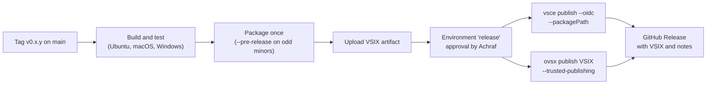

# Publishing Streamscope

Status: draft for approval, 2026-11-11. Nothing is published, pushed or submitted without the user's go-ahead.

## Identity (reserved 2026-11-11)

| Item                  | Value                                                                                | Status                                                                                                                                             |
| --------------------- | ------------------------------------------------------------------------------------ | -------------------------------------------------------------------------------------------------------------------------------------------------- |
| Extension name        | `streamscope`                                                                        | Free on both registries when checked                                                                                                               |
| Display name          | Streamscope: HTTP Client with Live Streaming                                         | To confirm free on the Marketplace before the first publish (display names must be unique)                                                         |
| Extension id          | `achrafelkhnissi.streamscope`                                                        |                                                                                                                                                    |
| Marketplace publisher | [`achrafelkhnissi`](https://marketplace.visualstudio.com/publishers/achrafelkhnissi) | Created; personal Microsoft account; profile links to GitHub, LinkedIn and X                                                                       |
| Open VSX namespace    | `achrafelkhnissi`                                                                    | Created; Publisher Agreement signed; ownership claim [EclipseFdn/open-vsx.org#15561](https://github.com/EclipseFdn/open-vsx.org/issues/15561) open |
| Repository            | [`achrafelkhnissi/streamscope`](https://github.com/achrafelkhnissi/streamscope)      | Public, empty                                                                                                                                      |
| License               | MIT                                                                                  | Added in milestone M0                                                                                                                              |

**Pending clean-up:** the Open VSX administrator was given temporary Reader access to the Marketplace publisher for the namespace claim. Remove that member from the publisher's **Members** tab once issue #15561 is closed.

## Manifest for the Marketplace

| Field                              | Value                                                                                                                                                          |
| ---------------------------------- | -------------------------------------------------------------------------------------------------------------------------------------------------------------- |
| `name`, `publisher`, `displayName` | As above                                                                                                                                                       |
| `description`                      | "Send requests from .http files and watch streaming responses (NDJSON, SSE, LLM streams) arrive event by event. Capture values from any event and reuse them." |
| `version`                          | `major.minor.patch` only (section "Versioning")                                                                                                                |
| `engines.vscode`                   | `^1.101.0`, with `@types/vscode` pinned to the same version                                                                                                    |
| `categories`                       | `Programming Languages`, `Testing`, `Other`                                                                                                                    |
| `keywords`                         | `http`, `rest`, `rest client`, `api`, `sse`, `server-sent events`, `ndjson`, `streaming`, `llm`, `agent`, `ag-ui`, `api testing`                               |
| `icon`                             | `images/icon.png`                                                                                                                                              |
| `galleryBanner`                    | Colour and theme chosen with the icon                                                                                                                          |
| `license`                          | `MIT`                                                                                                                                                          |
| `repository`, `bugs`, `homepage`   | GitHub repository, its issues page, its README                                                                                                                 |
| `pricing`                          | `Free`                                                                                                                                                         |
| `preview`                          | `true` until 1.0 **(builder's call)**; shows a Preview badge                                                                                                   |

## Icon and branding

- PNG, at least 128×128 px (designed at 256×256); SVG icons are not allowed. Designed in milestone M11.
- Must read clearly on light and dark Marketplace themes.
- No other product's marks.

## README and documentation

- README sections: what it does (one short screen recording of a live stream), quick start, `.http` syntax with Streamscope directives, capture and check reference, environments and secrets, settings, coexistence with REST Client, privacy (no telemetry, no account, no traffic except your requests), security notes.
- Images and recordings must use `https` URLs; SVG images only from trusted badge providers. Recordings live in the repository and are linked through `raw.githubusercontent.com`.
- `SECURITY.md` with a private reporting channel (GitHub security advisories).
- All examples use synthetic APIs and data.

## Versioning

- Only `major.minor.patch`; the Marketplace does not accept semver pre-release tags.
- Odd minor = pre-release, published with `--pre-release`; even minor = release. Versions are never reused, and a pre-release and a release never share a version.
- `0.x` while the syntax may still change; `1.0.0` once the team has used it for a full release cycle without syntax changes **(builder's call)**.
- Plan: `0.1.x` pre-release for the team trial, `0.2.0` first public release.

## Changelog

`CHANGELOG.md` in Keep a Changelog style: an `Unreleased` section during development, then one section per version with Added, Changed, Fixed and Security. The Marketplace shows it as the Changelog tab.

## Packaging

- `npm run package` runs `vsce package --no-dependencies` (bundle only, no `node_modules`) after the production build.
- The `files` allowlist keeps the VSIX to the bundle, manifest, README, CHANGELOG, LICENSE and icon.
- vsce's secret scan runs on every package; it must pass without allow flags.
- `npm run verify:vsix` installs the package into an isolated profile and checks activation.
- CI fails if the VSIX grows over 400 KB.

## Release process

- One workflow file, `.github/workflows/release.yml`, triggered by version tags.
- The same VSIX goes to both registries.
- The publish job has `id-token: write`, runs only in the `release` environment, and every action is pinned to a commit SHA.
- No long-lived publishing tokens are stored. Global Azure DevOps PATs are retired on 2026-12-01; the Marketplace path is OIDC trusted publishing.

## One-time setup before the first release (milestone M12)

1. **Marketplace trusted publishing:** publisher `achrafelkhnissi` → Trusted Publishing → Create. Policy name "Release workflow", repository owner `achrafelkhnissi`, repository `streamscope`, workflow `release.yml`, environment `release`.
2. **GitHub environment:** create `release` in the repository settings with Achraf as required reviewer.
3. **First Marketplace version:** publish through the workflow. If the Marketplace refuses OIDC for an extension that does not exist yet (unverified), upload the first VSIX on the publisher page (New extension → Visual Studio Code) by hand; later versions use the workflow.
4. **First Open VSX version:** after claim #15561 is approved, Achraf creates an Open VSX access token and publishes the same VSIX once from his own terminal, entering the token in a hidden prompt (never in chat or in files). Then: Open VSX Settings → Trusted Publishers → GitHub Actions, owner `achrafelkhnissi`, repository `streamscope`, workflow `release.yml`, environment `release`; then delete the token. Open VSX requires an owned namespace and an existing extension for trusted publishing.
5. **Clean-up:** remove the temporary Reader member from the Marketplace publisher.
6. **Later, optional:** verified publisher badge, which needs a domain registered for at least 6 months and an extension on the Marketplace for at least 6 months.

## Updates

- Pre-releases on odd minors let the team test changes before everyone gets them.
- Patch releases for fixes; release notes in the changelog.
- Dependabot proposes updates; the npm 7-day release cooldown applies; new dependencies still need the user's approval.
- Raising the minimum VS Code version is a minor-version change and is called out in the changelog.
- **Unpublish** hides the extension but keeps its name; **remove** deletes statistics and reserves the name permanently. Neither is planned.

## Pre-publish checklist

- [ ] All milestone gates green; benchmarks within budget
- [ ] Version, changelog and README updated
- [ ] Display name still free on the Marketplace
- [ ] `--skip-license` and `--allow-missing-repository` no longer used
- [ ] VSIX contents checked with `npm run package:list`
- [ ] Release environment approval given
- [ ] After publishing: install from each registry in a clean profile and send a streaming request
