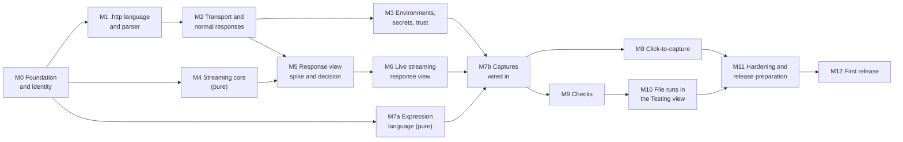

# Streamscope implementation roadmap

Status: approved 2026-11-11. Each milestone is small enough to test on its own and ends with a working, packaged extension. Before a milestone starts, it gets a detailed task plan, which the user approves; nothing in this roadmap is implemented before then.

Every milestone also meets the standing gate: `npm run check` passes, `npm run test:integration` passes on VS Code 1.101.0 and stable when VS Code-facing code changed, `npm run verify:vsix` passes when packaging or activation changed, and the relevant review agent (`vscode-api-verifier`, `extension-security-reviewer`) reports no open issues.

## Order and parallel work

- **Can run in parallel:** M4 (streaming core) and M7a (expression language) are pure TypeScript with no VS Code dependency, so they can proceed alongside M1 to M3. M8 and M9 can proceed in parallel after M7b.
- **Must stay sequential:** M0 before everything; M5 needs both transport (M2) and the streaming core (M4); M6 needs the M5 decision; M10 needs checks (M9); M12 needs everything, plus the Open VSX namespace claim to be closed.

## M0 Foundation and identity

- **Objective:** the project carries its real identity and runs in CI.
- **Includes:** rename to Streamscope (`name: streamscope`, `publisher: achrafelkhnissi`, display name "Streamscope: HTTP Client with Live Streaming", command prefix `streamscope.`), MIT `LICENSE`, `repository`/`bugs`/`homepage` fields, `extensionKind: ["workspace", "ui"]`, removal of `--skip-license --allow-missing-repository`, GitHub Actions CI, Dependabot.
- **Tasks:** update the manifest, tests and `CLAUDE.md`; add `.github/workflows/ci.yml` (typecheck, lint, format check, unit tests on Ubuntu, macOS and Windows; integration tests on 1.101.0 and stable, under `xvfb-run` on Linux; package and `verify:vsix` on macOS); SHA-pin every action; first commit and push to `achrafelkhnissi/streamscope` (only with the user's go-ahead).
- **Depends on:** nothing.
- **Acceptance:** CI green on all three systems; the VSIX installs as `achrafelkhnissi.streamscope`; the manifest test checks the new identity.
- **Tests:** existing suites, updated.
- **Deliverables:** renamed manifest, `LICENSE`, CI workflow, first commit on GitHub.

## M1 .http language and parser

- **Objective:** `.http` files open as `http`, look right, and are understood structurally.
- **Includes:** parser for REST Client syntax and Streamscope directives; grammar `source.http.streamscope`; outline; folding; syntax diagnostics.
- **Tasks:** `src/http-file` parser producing requests with ranges; TextMate grammar; document symbol and folding providers; diagnostic provider for syntax.
- **Depends on:** M0.
- **Acceptance:** a synthetic corpus of REST Client files parses identically to REST Client's interpretation (request boundaries, names, variables, bodies); outline and folding show one entry per request; colouring covers directives.
- **Tests:** parser unit tests (separators, comments, directives, bodies, `< file`, edge cases such as `###` inside bodies); integration tests for outline, folding and diagnostics.
- **Deliverables:** language support with no sending yet.

## M2 Transport and normal responses

- **Objective:** send a request and see a normal response reliably.
- **Includes:** `node:https` transport with redirects, decompression (gzip, deflate, br, zstd), timeouts, per-request TLS opt-out, custom CA merge, timing, cancellation; Send and Stop commands, CodeLens and `Cmd+Alt+Enter`; one-time notice offering to turn off REST Client's and httpyac's Send CodeLens; file and system variables; a basic response document (status, Headers, pretty Body); Save Response; redacting log channel.
- **Tasks:** `src/transport`; request builder from the parser; `src/variables` with file and system variables; response session model; basic native response document; masking registry skeleton.
- **Depends on:** M1.
- **Acceptance:** requests to a local test server succeed for every method and body type; redirects show each hop; a 50 MB JSON body opens without freezing; cancel closes the socket; TLS opt-out works only for the marked request; proxy settings apply (patch harness).
- **Tests:** transport tests against real local `node:http`, raw `net` and self-signed TLS servers; VS Code patch harness under Electron; integration tests for send, cancel and view.
- **Deliverables:** a usable REST-Client-like extension for non-streaming requests.

## M3 Environments, secrets and Workspace Trust

- **Objective:** variables come from all agreed sources, and secrets never leak.
- **Includes:** `rest-client.environmentVariables` (with `$shared`), `http-client.env.json` and `http-client.private.env.json`, environment picker, `$dotenv`, `$processEnv`, `{{$secret}}` with Set/Clear/List Secret commands, "Move to secret storage" quick fix, masking everywhere, Workspace Trust limited mode, variable hovers, completion and unresolved-variable diagnostics.
- **Tasks:** environment readers and watchers; precedence rules (design section 10); SecretStorage wrapper keyed per workspace; masking registry used by log, hovers and view; restricted-mode gates.
- **Depends on:** M1, M2.
- **Acceptance:** each variable source resolves with the documented precedence and the hover shows the source; secrets never appear in any output; restricted mode blocks secret, dotenv, private env, process env and body files.
- **Tests:** resolver unit tests; masking snapshot tests; integration tests in trusted and restricted workspaces; secret storage round trip.
- **Deliverables:** environments and secrets ready for the team's files.

## M4 Streaming core (pure)

- **Objective:** bytes in, correct events out, at speed and with bounded memory.
- **Includes:** streaming UTF-8 decoding, line framer, format detector with upgrade, SSE and NDJSON interpreters, reply adapters (AG-UI, OpenAI Chat Completions, OpenAI Responses, Anthropic, Ollama), event store with ring buffer and spill file, update batcher, synthetic stream server and benchmark harness.
- **Tasks:** `src/streaming` and `src/events`; install the approved dev dependency `eventsource-parser` as a test reference; byte-boundary test generator; synthetic fixtures; benchmark server emitting configurable event rates for long durations.
- **Depends on:** M0.
- **Acceptance:** every fixture split at every byte boundary yields identical events; SSE results match the reference parser; malformed and oversize lines are reported and skipped; 30 minutes at 1,000 events/s stays under the memory budget; parsing keeps up with 5,000 events/s on a laptop.
- **Tests:** unit, byte-boundary and property-style table tests (written with the `stream-parser-test-author` agent); benchmark run recorded in `docs/benchmarks.md`.
- **Deliverables:** the streaming engine, not yet visible in the UI.

## M5 Response view spike and decision

- **Objective:** choose the response surface with data, not guesses.
- **Includes:** two throwaway prototypes (native virtual document with view switching, and hardened webview with a virtualized event list) fed by M2 transport and M4 pipeline from the synthetic server.
- **Tasks:** measure p95 event latency, extension host long tasks, renderer CPU and memory over a 30-minute run at 500 events/s; walk through the approved mockup (tabs, live switching, event detail, Stop, captured values, click-to-capture entry point); write `docs/decisions/response-surface.md`.
- **Depends on:** M2, M4.
- **Acceptance:** measurements recorded for both; recommendation written; **the user approves the choice**.
- **Tests:** benchmark runs; manual walkthrough with screenshots.
- **Deliverables:** decision record and kept benchmark tooling; prototype code is deleted.

## M6 Live streaming response view

- **Objective:** the main differentiator: events visible live, one at a time.
- **Includes:** the chosen surface with Events (default, remembered), Reply, Raw (coloured), Headers, Body, live status, Stop, event detail, save stream as `.ndjson`/`.sse`; Show History (last 50 runs); CodeLens and status bar live state. The layout target is [mockups/response-view.html](mockups/response-view.html).
- **Tasks:** presenters subscribing to the batcher; view switching without data loss; reply view via adapters; paging of older events from the spill file.
- **Depends on:** M5.
- **Acceptance:** section 3 latency, responsiveness and memory budgets met in the benchmark; switching views mid-stream keeps everything; Stop ends the run cleanly with partial data visible; NDJSON labelled `application/json` streams live.
- **Tests:** integration tests for view switching, Stop and saving; benchmark; accessibility and theme manual pass.
- **Deliverables:** live streaming for users; a good point for an early internal build for the team.

## M7 Expression language and captures

M7a (pure, parallel) and M7b (wiring) are tracked together.

- **Objective:** no more copying ids by hand.
- **Includes:** the full capture language (sources, paths, conditions, filters, `jsonpath()`), `secret`, `{{request.name}}` and `{{name}}`, REST Client `{{name.response.body.$…}}` and `{{name.response.headers.X}}`, waiting with timeout, blocking with clear errors, inlay hints, expression diagnostics.
- **Tasks:** `src/expressions` lexer, parser and evaluator with error positions; install the approved runtime dependency `@swaggerexpert/jsonpath` and run the JSONPath compliance test suite in CI; `src/capture` registry, states, provenance and waiting; resolver integration; lossless number handling.
- **Depends on:** M7a needs M0 only; M7b needs M3, M4, M6 and M7a.
- **Acceptance:** the threadId/messageId scenario works end to end against a synthetic AG-UI NDJSON server, including sending the follow-up while the first stream is still running; every failure mode blocks the request with a precise message; large integer ids keep their digits.
- **Tests:** grammar and evaluator unit tests; capture semantics with scripted event sequences (late, missing, malformed, cancelled, failed); integration test of the two-request flow.
- **Deliverables:** captures for users.

## M8 Click-to-capture

- **Objective:** capture any value without typing an expression.
- **Includes:** "Capture This Value…" on event detail and Body views; path computation from the selected JSON value; suggested condition from the event's type field and occurrence; name prompt; writing the line above the producing request.
- **Depends on:** M6, M7b.
- **Acceptance:** for any value in a fixture, the generated expression evaluates back to that value; the generated line is valid and placed on the right request.
- **Tests:** round-trip unit tests (value → expression → value); integration test of the command.
- **Deliverables:** point-and-click capture.

## M9 Checks

- **Objective:** expectations checked automatically, live.
- **Includes:** `# @expect` evaluation with `exists`, `count`, `before`, `unique`; early failure; Checks view; ✓ / ✗ decorations; status summary.
- **Depends on:** M7b.
- **Acceptance:** checks settle at the earliest possible event and never change after settling; failures show expected and actual values; a failing check does not stop the stream.
- **Tests:** unit tests over scripted streams; integration test for decorations and view.
- **Deliverables:** checks for users.

## M10 File runs in the Testing view

- **Objective:** run a whole `.http` file as an end-to-end test.
- **Includes:** test controller (one suite per file, one test per request), gutter run buttons, file order execution, skip rules, `# @timeout`, `# @until`, run cancellation, results with failure messages.
- **Depends on:** M9.
- **Acceptance:** a synthetic multi-request file with captures and checks passes; a failed producer causes dependants to be skipped with the reason; stopping a run cancels the active request.
- **Tests:** integration tests through the Testing API.
- **Deliverables:** whole-file testing.

## M11 Hardening and release preparation

- **Objective:** ready for strangers.
- **Includes:** benchmark run against every budget; security review with the `extension-security-reviewer` agent and optionally the `claude-security` scan; accessibility and theme pass; README with short screen recordings, settings reference and privacy statement; icon (PNG, at least 128×128, designed at 256×256); CHANGELOG; Marketplace listing metadata (categories, keywords); release workflow (design in [publishing.md](publishing.md)); a dry run with `vsce package --pre-release`.
- **Depends on:** M8, M10.
- **Acceptance:** every budget met; no open high or medium security finding; README reviewed by the user; release workflow tested up to the approval gate.
- **Deliverables:** release candidate.

## M12 First release

- **Objective:** published, used by the team, then released to everyone.
- **Includes:** Marketplace trusted publishing policy; GitHub `release` environment with the user as required reviewer; pre-release `0.1.0` on the Marketplace; first Open VSX publish with an access token (run by the user), then Open VSX trusted publishing; team trial against the success criteria; fixes; release `0.2.0`.
- **Depends on:** M11; Open VSX namespace claim [#15561](https://github.com/EclipseFdn/open-vsx.org/issues/15561) closed (trusted publishing requires an owned namespace).
- **Acceptance:** both registries list the extension; installing from each works in a clean profile; the team confirms "no copied ids, events live"; the temporary Reader member is removed from the Marketplace publisher.
- **Deliverables:** Streamscope 0.2.0 on both registries.
